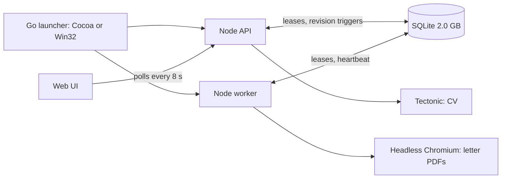
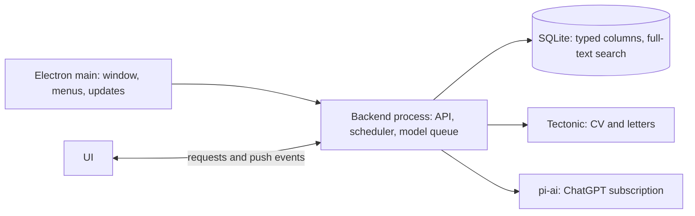

# Interview answers

Submitted answers; interpretation and accepted decisions are recorded through grill-me/plan in the [clean rebuild plan](2026-11-01-rebuild.md).

Session: `2429f43a2dda41cdf1aaa20116f739b4`

Previews were HTML mockups with fictional data. Descriptions marked *local* contained usage figures from the private database (opened, saved and applied counts, saves per source); the complete round is retained outside the wiki.

## Question 1

```text
Round: Rebuild from first principles
Question: Does this diagnosis match your experience of the app?
Description: local
Selection: single
Options: Matches / Partly — see notes / Does not match
Selected: Matches
Notes: 
```

## Question 2

```text
Round: Rebuild from first principles
Question: Who will install the app?
Description (Markdown source):
This decides how much signing, first-run setup and Windows support are worth. Your 18 October note says you want a downloadable Windows release on GitHub.
Recommendation: A public GitHub release. That matches your stated goal and justifies signing and a setup checklist.
Selection: single
Options: Only me / Me and a few people I give it to / Anyone, through a public GitHub release
Selected: Anyone, through a public GitHub release
Notes: 
```

## Question 3

```text
Round: Rebuild from first principles
Question: Which platforms should the rebuild support?
Description (Markdown source):
Unraid has never been deployed; its Docker image, XML template and supervisord exist but are unverified. Dropping a target removes its packaging code; it can be added back later because the backend stays a plain Node module.
Recommendation: macOS (Apple Silicon) and Windows 11 x64. Defer Unraid and Linux until you will actually run them.
Selection: multiple
Options: macOS (Apple Silicon) / Windows 11 x64 / Unraid / Docker server / Linux desktop
Selected: macOS (Apple Silicon) / Windows 11 x64
Notes: 
```

## Question 4

```text
Round: Rebuild from first principles
Question: What makes the current Windows build unusable?
Description (Markdown source):
Pick everything you have seen. This checks whether the proposed runtime change addresses the real failures.
Selection: multiple
Options: Installation fails or is confusing / Blank window or will not start / Slow or freezes / Crashes or stops in the background / ChatGPT sign-in fails / Scans fail / CV or letter PDFs fail / Layout or text looks wrong / Have not used it recently
Selected: Installation fails or is confusing / Blank window or will not start / Slow or freezes / Crashes or stops in the background
Notes: 
```

## Question 5

```text
Round: Rebuild from first principles
Question: Which desktop runtime should the rebuild use?
Description (Markdown source):
Current architecture:



| | Electron | Tauri + Node sidecar | Keep Go shells, trimmed |
| --- | --- | --- | --- |
| Languages | TypeScript | TypeScript + Rust | TypeScript + Go + Objective-C + PowerShell |
| Bundled runtimes | Electron (Node + Chromium), Tectonic | Node, Tectonic; system webview | Node, Tectonic; system webview |
| Rendering | Chromium on both | WebKit on Mac, WebView2 on Windows | WebKit on Mac, WebView2 on Windows |
| Installers, signing, auto-update | electron-builder + electron-updater | Tauri bundler + updater plugin | Hand-written |
| Unpacked size (estimate) | ~300 MB | ~180 MB | ~170 MB |
| Download (estimate) | ~120 MB | ~70 MB | ~70 MB |

Estimates are unmeasured: typical runtime sizes plus Tectonic (48 MB) and its package cache (20 MB). All three drop headless Chromium and the shipped `node_modules`, which is most of today’s size. Risk to check early with Electron: whether its Node build includes `node:sqlite`; otherwise use `better-sqlite3`.
Recommendation: Electron. It has the fewest moving parts: one language, no separate Node binary or Chromium download, and maintained installers and updates on both platforms. It removes the custom Windows host, process supervision and installer, where the Windows-only code lives. It costs roughly 120 MB more on disk than Tauri.
Selection: single
Options: Electron / Tauri + Node sidecar / Keep Go shells, trimmed
Selected: Electron
Notes: 
```

## Question 6

```text
Round: Rebuild from first principles
Question: How should releases be signed and updated?
Description (Markdown source):
Without signing, macOS blocks the first open until you allow it in System Settings, and macOS auto-update requires a signed app. Windows shows a SmartScreen warning. Signing costs the Apple Developer Program (US$99/year) and a paid Windows certificate or signing service. Releases would be published as GitHub Releases in every option.
Recommendation: Sign and notarize both, with automatic updates, if anyone besides you will install it. If it is only for you, choose unsigned with an update notice.
Selection: single
Options: Sign both; automatic updates / Sign macOS only; Windows unsigned with an update notice / Unsigned on both; in-app notice links to the new release
Selected: Unsigned on both; in-app notice links to the new release
Notes: 
```

## Question 7

```text
Round: Rebuild from first principles
Question: How should the rebuild happen?
Description (Markdown source):
**Port largely unchanged** (about 8,500 lines that already work): source adapters and parsers, matching, eligibility, deduplication, location and timezone data, pi-ai runtime and credentials, assistant actions and validation, LaTeX compilation, the ZIP backup format.

**Rewrite:** desktop shell and packaging, process model, database schema and queries, API, UI.

**Data moves through the existing ZIP export.** The new app imports a backup and applies the new storage rules from the question on stored jobs. The old app stays usable until the new one reaches parity.
Recommendation: Rebuild alongside in this repo and port the proven modules. Rewriting the shell, storage and UI in place would leave both versions half-working for weeks.
Selection: single
Options: Rebuild alongside; port proven modules; import via ZIP / Refactor the current app in place, one step at a time / Start clean; import only profile, CV and letters
Selected: Start clean; import only profile, CV and letters
Notes: dont import profile or CV. start completely clean. but keep a backup of my data, and put it on ~/Desktop/ununemploy-backup
```

## Question 8

```text
Round: Rebuild from first principles
Question: Should the backend run as one process?
Description (Markdown source):
Proposed architecture:



One backend process owns the API, the scan scheduler and the serialized model queue. The UI receives push events when data changes. This removes worker leases, heartbeats, the `data_revisions` triggers, revision-hint headers, 8-second polling and the 15-second request timeout. Serialized model work is an in-process queue instead of a polled table; queued work still persists in SQLite so it survives restarts.
Recommendation: One process. Most stale-state and timeout bugs come from two processes coordinating through the database.
Selection: single
Options: One backend process with push updates / Keep separate API and worker processes
Selected: One backend process with push updates
Notes: 
```

## Question 9

```text
Round: Rebuild from first principles
Question: Which jobs should the app keep?
Description: local
Recommendation: Keep Strong and Adjacent unless Incompatible (about 14,400 today), keep a fingerprint for the rest, and delete unsaved jobs 30 days after they close. Drop the HTTP body cache and description history for unsaved jobs. The database should fall from 2 GB to tens of MB.
Selection: single
Options: Keep Strong and Adjacent; fingerprint the rest; expire closed unsaved jobs / Keep every job; drop only the HTTP body cache and history / Keep everything (current)
Selected: Keep Strong and Adjacent; fingerprint the rest; expire closed unsaved jobs
Notes: 
```

## Question 10

```text
Round: Rebuild from first principles
Question: How should cover-letter PDFs be produced?
Description (Markdown source):
Headless Chromium (198 MB macOS, 274 MB Windows) exists only for letter PDFs and legacy resume exports. `docx` and Handlebars serve only legacy resumes. A LaTeX letter template would use the same fields as today (company, role, greeting, plain-text paragraphs, signature), with text escaped for LaTeX. Existing legacy resumes would be exported once as files and kept in appdata.
Recommendation: Render letters with the same Tectonic engine as the CV. One document engine, letters that match the CV’s typography, and no browser dependency.
Selection: single
Options: LaTeX for CV and letters / Electron's built-in print-to-PDF with the current HTML layout / Keep headless Chromium
Selected: Something else
Notes: just generate CVs in plain text.
```

## Question 11

```text
Round: Rebuild from first principles
Question: Do you accept these implementation choices?
Description (Markdown source):
| Area | Current | Rebuild |
| --- | --- | --- |
| Packaging | `tsx` at runtime; full `node_modules` shipped | Backend bundled with esbuild into one file |
| Database | JSON documents + in-memory snapshot index | Typed columns for filters and sort, SQL indexes, FTS5 search; JSON only for raw source evidence |
| UI server state | Custom `useRemote`, ETag polling, revision hints | TanStack Query, invalidated by push events |
| Routing | Hash routes inside a 1,448-line `App.tsx` | One module per page; the router keeps unsaved-edit guards |
| Assistant UI | assistant-ui runtime (295 KB chunk) | Plain message list and composer |
| LaTeX editor | react-codemirror wrapper (964 KB chunk + 273 KB CSS) | CodeMirror 6 with only the needed extensions |
| PDF preview | pdf.js (1.1 MB worker) | Built-in Chromium PDF viewer |
| Tests | 27 `verify-*` scripts + node tests | Ported unit tests + one Playwright suite against the packaged app on both platforms |
| Diagnostics | Logs in appdata | Settings → Diagnostics: versions and recent errors, copyable, no personal data |
Recommendation: Accept. Each change removes code or a dependency; TanStack Query is the only new library, and it replaces hand-written caching and polling.
Selection: single
Options: Accept / Accept with changes in notes / Discuss alternatives first
Selected: Accept
Notes: 
```

## Question 12

```text
Round: Rebuild from first principles
Question: What should the opening screen be?
Description: local
Recommendation: Triage inbox. It turns the collection into a short daily queue you can clear.
Selection: single
Options: Triage inbox (proposed) / Current browse-all inbox
Selected: Triage inbox (proposed)
Notes: 
```

## Question 13

```text
Round: Rebuild from first principles
Question: Where should your job criteria live?
Description (Markdown source):
Today, location, timezone, arrangement, eligibility and match level are inbox filters restored per browser tab, while the profile separately stores preferences used for matching. Two places describe what you want. In the proposal, Profile → Search criteria decides what is collected and what appears in New. Filters only narrow a view temporarily. See the Profile question for a preview.
Recommendation: In Profile as search criteria. Set them once; they also stop irrelevant jobs from being stored.
Selection: single
Options: Profile → Search criteria; filters narrow temporarily / Keep everything as inbox filters (current)
Selected: Profile → Search criteria; filters narrow temporarily
Notes: 
```

## Question 14

```text
Round: Rebuild from first principles
Question: How should timezone fit be expressed?
Description (Markdown source):
The current picker selects a UTC range on a map with a separate rotating offset; it took four iterations on 18 October to handle the date-line seam. An overlap rule asks the question directly and wraps around midnight without a seam. Example: US Pacific gives 1 h of overlap with Kuala Lumpur. Matching stays country-level as today, so the United States matches 3 h through Hawaii. Try the slider.
Recommendation: Minimum working-hours overlap with your timezone, stored in search criteria.
Selection: single
Options: Minimum overlap with my working hours / Current UTC range, map and offset / No timezone filtering
Selected: Minimum overlap with my working hours
Notes: 
```

## Question 15

```text
Round: Rebuild from first principles
Question: How should a job's fit be shown?
Description (Markdown source):
Today: a six-field metadata grid (several reading “Not listed” or “Unconfirmed”), then Description, Match, Notes and Cover letter tabs. Match evidence sits in its own tab, away from the text it refers to. The proposal leads with a summary of the deciding facts, then highlights matched and missing requirements inside the description.
Recommendation: Decision summary and highlighted description. You read the reasons where they appear.
Selection: single
Options: Decision summary + highlighted description / Current grid and Match tab
Selected: Decision summary + highlighted description
Notes: 
```

## Question 16

```text
Round: Rebuild from first principles
Question: How should a saved job be worked on?
Description (Markdown source):
Today the letter is a tab in the half-width detail pane, below the metadata grid, edited as separate form fields. In the proposal, a saved job opens a workspace: the posting and notes on the left, the letter as a document on the right, with review notes and status visible. Contact fields stay in the letter's settings.
Recommendation: Posting and letter side by side. Checking the letter against the posting is the main task here.
Selection: single
Options: Posting and letter side by side / Current letter tab
Selected: Posting and letter side by side
Notes: 
```

## Question 17

```text
Round: Rebuild from first principles
Question: What should the app record after you save a job?
Description: local
Recommendation: Saved and Applied only, with the status selector in the job header and the date in the list. Add interview stages later if you find you need them.
Selection: single
Options: Saved and Applied, shown in the header and list / Add stages: Applied, Interviewing, Offer, Closed, with dates / Saved only; remove Applied
Selected: Saved and Applied, shown in the header and list
Notes: 
```

## Question 18

```text
Round: Rebuild from first principles
Question: How should the profile be shown and edited?
Description (Markdown source):
The current view renders the stored JSON as Markdown, including internal fields such as Id and Year/Month/Display “Not provided”. The proposal is a fact sheet: search criteria, eligibility, experience, projects and missing facts, each with its status and source. Direct editing would revise the 8 October read-only decision; direct edits are recorded as yours with a date, and the assistant remains available for imports and bulk changes.
Recommendation: Fact sheet with direct editing as well as the assistant. Changing a phone number through chat is the clunkiest path.
Selection: single
Options: Fact sheet; edit directly or with the assistant / Fact sheet; assistant-only edits / Current Markdown view
Selected: Fact sheet; edit directly or with the assistant
Notes: 
```

## Question 19

```text
Round: Rebuild from first principles
Question: What should the main navigation contain?
Description (Markdown source):
Sources are set up once and checked occasionally, but today they take a top-level page. The proposal puts them in Settings with per-source job and save counts. A failing source puts a dot on Settings, and Saved counts letters ready to review. The counts shown are your current collection; the statuses are illustrative.
Recommendation: Inbox, Saved, Profile and CV, with Sources inside Settings.
Selection: single
Options: Inbox, Saved, Profile, CV; Sources in Settings / Keep Sources as a top-level page
Selected: Inbox, Saved, Profile, CV; Sources in Settings
Notes: 
```

## Question 20

```text
Round: Rebuild from first principles
Question: Which sources should the rebuilt app keep?
Description: local
Recommendation: Keep the first three groups. Drop scraped boards without saves, X and the boards that never returned a job. Scraped boards break when sites change, and X needs paid credits and budget code. Hacker News is optional.
Selection: multiple
Options: Sources with saves / Company boards (Greenhouse, Ashby, Lever) / Structured feeds and APIs without saves / Scraped boards without saves / Hacker News / X search / Boards that never returned a job
Selected: Sources with saves / Company boards (Greenhouse, Ashby, Lever) / Structured feeds and APIs without saves / Scraped boards without saves
Notes: 
```

## Question 21

```text
Round: Rebuild from first principles
Question: Which additions should the rebuild include?
Description (Markdown source):
| Addition | What it does |
| --- | --- |
| Keyboard triage | J/K move, S save, X skip, O open posting, / search |
| Setup checklist | First run: connect ChatGPT → build profile from your CV PDF → choose sources → first scan |
| Hide company | One action on a job hides that employer's future postings |
| Track company | From a job on Greenhouse, Ashby or Lever, add that employer's board as a source |
| Status counts | Saved shows letters ready to review; Settings shows failing sources or a needed sign-in |
| Record versions when applying | Marking Applied records which letter and CV versions were current |
| Saved views | Named filter combinations in the sidebar |
Recommendation: Everything except saved views. Search criteria cover the main need for saved views.
Selection: multiple
Options: Keyboard triage / Setup checklist / Hide company / Track company / Status counts / Record versions when applying / Saved views
Selected: Keyboard triage / Setup checklist / Hide company
Notes: 
```

## Question 22

```text
Round: Rebuild from first principles
Question: Which removals should the rebuild make?
Description (Markdown source):
Sources, timezone, the Match tab and platforms are covered by earlier questions.

| Removal | Why |
| --- | --- |
| Seen state and filter | Replaced by New/All and bold unopened titles; 73 opens recorded |
| Duplicate grouping control | Always group; the detail lists other listings |
| Legacy resume code (`docx`, Handlebars, export routes) | Export existing resumes once to files |
| Retired Jev code, migration and archive compatibility | Export stored Jev data once to a file |
| HTTP body cache | 979 MB; keep only ETag/Last-Modified validators |
| Description history for unsaved jobs | 380 MB; saving still snapshots the description |
| VueJobs detail enrichment | Special six-per-day lookup path for one feed |
| Custom installer and checksum inventory | Replaced by the packaging tool |
Recommendation: All of them. Each removes code or stored data with no current use.
Selection: multiple
Options: Seen state and filter / Duplicate grouping control / Legacy resume code / Retired Jev code / HTTP body cache / Description history for unsaved jobs / VueJobs detail enrichment / Custom installer and checksum inventory
Selected: Seen state and filter / Duplicate grouping control / Legacy resume code / Retired Jev code / HTTP body cache / Description history for unsaved jobs / VueJobs detail enrichment / Custom installer and checksum inventory
Notes: 
```

## Question 23

```text
Round: Rebuild from first principles
Question: What else feels clunky or breaks in daily use?
Description (Markdown source):
Anything not covered above: specific screens, waits, errors or steps you avoid. Paste screenshots if useful.
Selected: (none)
Notes: 
```
