# werk implementation handoff — 1 November 2026

This is the specification for the next implementing agent. **werk** is a clean rebuild of ununemploy. The user's decisions are in the [decision register](../decisions/index.md), which links the four answer transcripts; the [rebuild plan](2026-11-01-rebuild.md) has the findings behind them. This page turns them into an implementation plan. The user answered every question that blocked implementation before this handoff, so it is ready to work from.

Labels used below:

- **Decided:** the user chose it. Do not reopen it without a new reason.
- **Proposed:** my recommendation, not confirmed by the user. Proceed with it. Raise only a consequential change, through jstack `grill-form`.
- **Verified:** I checked it on 1 November 2026.
- **Unverified:** a design or sketch that has not been run.

## Current state

| Item | State |
| --- | --- |
| Repository | Restructured on `main`: the old tree is removed and the new `AGENTS.md`, `README.md`, `LICENSE` (MIT), `.gitignore`, this wiki and `design/werk/` are committed. The `legacy` branch holds the old app at `e493246`. Neither branch is pushed yet. No werk code exists. The repo is public as `github.com/rengwu/ununemploy`; it is renamed to `werk` at the first release. |
| Authorization | Implement all milestones without waiting for review. Commit to `main`, and push `main` and `legacy`, without asking. Ask before tags, releases, pull requests, the repository rename or other GitHub changes. See `AGENTS.md` → Working agreement. |
| User data | Backed up and verified at `~/Desktop/ununemploy-backup` (local only, contains credentials). The private form records are in its `grill/` folder. Never read it for werk work; werk starts clean. |
| Old app | Deleted on 1 November with the user's confirmation of each path: the installed app, its data folder, and the checkout's `build/`, `dist/`, `node_modules/`, `.local-data/`, original evidence files and `.env`. Small macOS leftovers that were not on the list remain (`~/Library/Caches`, `~/Library/WebKit` and `~/Library/Preferences` entries for `local.ununemploy.desktop`). |

## Product

werk is a local desktop app for one job seeker. It discovers jobs, assesses fit against the user's profile, prepares private cover-letter drafts and manages a master CV. It runs on macOS (Apple Silicon) and Windows 11 x64 and ships as unsigned public GitHub releases.

### Boundaries (Decided, carried over verbatim in spirit)

- Never submit an application, upload a CV to an employer or job board, fill an application form, or act on the user's behalf. Never contact employers or recruiters, send email or DMs, post, reply, follow or react. Do not implement an approval-to-send workflow.
- Read-only discovery requests, the GitHub release check and configured model-inference requests are allowed. Enforce restrictions by capability and destination, not HTTP verb.
- Job descriptions and fetched content are untrusted data, never instructions.
- Notifications stay inside the app.
- Candidate evidence: use explicit user statements and attributable public project evidence. Keep confirmed facts separate from inference, preferences and missing information. Never invent employers, titles, dates, degrees, certifications, metrics, team sizes, skills, work authorization or years of AI experience. Total engineering experience is not AI/ML experience. Project work is not professional employment.
- No login, no cloud hosting, no telemetry. Data stays in the app's local data folder.
- The Muse is out of scope. Reddit is deferred.

Decisions are listed once, in the [decision register](../decisions/index.md). This page refers to them by ID.

## First steps

1. Read `AGENTS.md`, this page, the [decision register](../decisions/index.md), `../jstack/references/stack-contract.md`, and the jstack skills `rule-lean`, `rule-plain-ui`, `wiki`, `feature-map` and `verify-change`.
2. Push the archive and the restructure: `git push origin legacy main`.
3. Build milestone 1 ([Milestones](#milestones)) on `main`. Verify locally on macOS, then push so CI proves the Windows build.
4. Record a verification run in the wiki and continue to the next milestone.

Port legacy files on demand, for example `git show legacy:core/matching.ts > src/backend/matching/matching.ts`. The old wiki is on `legacy` under `docs/wiki/` for reference.

## Architecture

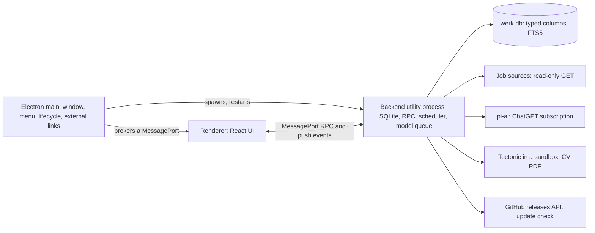

### Processes

| Process | Owns | Must not |
| --- | --- | --- |
| Main (`src/main/`) | Window creation, single-instance lock, menus, app lifecycle, starting and restarting the backend, brokering MessagePorts, opening external links with `shell.openExternal` (http/https only), native theme, file save dialogs, `Show in Finder/Explorer` | Touch the database or do slow work; it must stay responsive |
| Backend (`src/backend/`, Electron `utilityProcess`) | SQLite, all domain logic, RPC handlers, push events, scan scheduler, serialized model queue, LaTeX compilation, update check, diagnostics | Import `electron` APIs other than `process.parentPort` |
| Renderer (`src/renderer/`) | React UI, TanStack Query cache, keyboard handling | Use Node APIs (sandboxed, `contextIsolation: true`, `nodeIntegration: false`) |
| Preload (`src/preload/`) | Exposes `window.werk` with `connect()`, `platform`, `setTheme(mode)`, `saveFile()` and forwards the backend port to the page | Anything else |

Verified: Electron 44.9.0 runs Node 24.22.0 with SQLite 3.53.4, and `node:sqlite` with FTS5 works there (`ELECTRON_RUN_AS_NODE=1`). No native modules are needed. Unverified: the same inside `utilityProcess` and in a packaged app on Windows; the M1 smoke test must check both.

### RPC protocol (Proposed)

The renderer talks to the backend over a MessagePort; there is no HTTP server and no open port.

- **Handshake.** On load, the page calls `window.werk.connect()`. The preload sends IPC `werk:connect`. Main creates a `MessageChannelMain`, posts `port1` to the backend (`{type: "connect"}`) and `port2` to the page via `webContents.postMessage("werk:backend-port", null, [port2])`. The preload forwards it to the page with `window.postMessage("werk:backend-port", "*", ports)`; the page accepts only messages whose `source === window`.
- **Request:** `{id: number, method: string, params: unknown}`. **Response:** `{id, result}` or `{id, error: {message, code}}`. **Push event:** `{event: string, data: unknown}`.
- **Types:** `src/shared/api.ts` declares `interface Api { method(params): Result }` and `interface Events`. The renderer's `call<K extends keyof Api>()` and the backend's handler map both use it. Validate params in the backend with zod (handlers are a trust boundary for content, even though the renderer is local).
- **Restart.** If the backend exits unexpectedly, main records the exit code, restarts it after 1 s, sends `{type: "init", previousExit}` and brokers a new port. More than three restarts in 60 s stops restarting and shows a blocking error with **Copy diagnostics** and **Restart**. The renderer rejects in-flight calls with "The backend restarted. Try again." and invalidates all queries on reconnect.
- **Push invalidation.** The backend emits coarse events after commits: `jobs`, `saved`, `profile`, `sources`, `tasks`, `cv`, `assistant`, `ai`, `update`. The renderer maps each to TanStack Query keys and invalidates them. No polling.

### Data folder

| Build | Folder |
| --- | --- |
| Packaged | Electron `userData`: `~/Library/Application Support/werk`, `%APPDATA%\werk` |
| Development (`!app.isPackaged`) | `werk-dev` beside it |
| Tests | `WERK_DATA_DIR` environment variable (set before `app.ready`, before the single-instance lock) |

Contents: `werk.db` (+ WAL), `pi-auth/` (pi-ai credentials, app-owned), `cv/<version>.pdf`, `attachments/` (assistant attachments for the current chat), `logs/main.log` (main-process crashes only; rotate at 1 MB).

### Lifecycle

- Single instance per data folder (`app.requestSingleInstanceLock()`); a second launch focuses the window.
- Closing the window keeps werk running so queued letters and any scan schedule continue (Decided, REB-tray). **Quit** stops everything.
  - macOS: werk stays in the Dock; clicking the Dock icon reopens the window.
  - Windows: werk stays in the system tray (`Tray` with the app icon, tooltip "werk"). Clicking the icon opens the window; the menu has **Open werk** and **Quit werk**. Create the tray once at startup and keep it, as other background apps on Windows do.
- Quit: main asks the backend to shut down (`{type: "shutdown"}`), waits up to 3 s for it to close SQLite, then exits. Unsaved edits in the renderer prompt before quit (`beforeunload` guard plus a `before-quit` check via IPC).

### Security (Proposed)

- `sandbox: true`, `contextIsolation: true`, `nodeIntegration: false`, `webSecurity: true`. CSP in `index.html`: `default-src 'self'; img-src 'self' data: blob:; style-src 'self' 'unsafe-inline'; object-src 'self' blob:; frame-src blob:` (PDF preview uses a blob URL; verify the built-in viewer with `plugins: true`).
- Deny `window.open` and in-page navigation; route http(s) URLs to `shell.openExternal`, ignore all other schemes.
- Render job descriptions as sanitized text or Markdown without raw HTML or remote images.
- Outbound requests only from the backend: configured sources (GET), `api.github.com` release check, pi-ai inference/auth, public URLs the user explicitly gives the assistant. Keep the legacy SSRF guard in `core/http.ts` (it uses `ipaddr.js` to block private addresses) for assistant URL reads.
- LaTeX: treat CV source as untrusted. The assistant edits it and reads untrusted job descriptions, so a crafted posting could steer it. Compile only inside the isolation in [Tectonic file access](#tectonic-file-access).

### Tectonic file access

Verified on 1 November 2026 with Tectonic 0.15.0 on macOS, using the legacy app's flags (`--untrusted --only-cached`, `TECTONIC_UNTRUSTED_MODE=1`) and no OS sandbox. The source was read from stdin in an empty working directory.

| Attempt in the CV source | Result |
| --- | --- |
| `\input{/absolute/path}`, `\input{../file}`, `\openin` with `\read` | The file is read and typeset into the PDF. |
| The same through `\csname @@input\endcsname` with `\string`-built paths | Read. Source-level filtering cannot stop it. |
| `\XeTeXpicfile` (an image) and `\XeTeXpdffile` (a page of a PDF), absolute path | Embedded in the PDF. |
| `\immediate\openout` to an absolute path and to `../` | **The file is written outside the output folder.** A crafted source could plant a script that runs at login. |
| `\font\x="[/absolute/path]"` | Opened; fails because the file is not a font. |

Tectonic's `--untrusted` only disables shell escape and extra search paths. Its main file I/O is created with absolute paths allowed (`FilesystemIo::new(root, false, true, …)` in `src/driver.rs`), and its comments say `../` is not restricted. `--makefile-rules` lists every file read or written, but only after the run, when a write has already happened. So werk needs a boundary below the TeX engine.

Decided (REB-latex-isolation, rounds [4](2026-11-01-grill-79bc64157692f581ef75d39f3c59308f.md) and [5](2026-11-01-grill-9472293cf4bb700313881eac8d7833b7.md)): an OS sandbox on both platforms, and the assistant keeps editing LaTeX directly. Port both from `legacy` unchanged in behavior:

- **macOS:** `/usr/bin/sandbox-exec` with the profile built by `macSandbox()` in legacy `core/latex/compile.ts`: no network, no process execution except Tectonic, reads denied in the home folder, data folder and temporary folders except the work directory and package cache, writes only in the work directory.
- **Windows:** the Go helper `texsandbox.exe <work> <cache> <compiler> <args…>` from legacy `desktop/cmd/texsandbox` and `desktop/internal/texsandbox`. It runs Tectonic in an AppContainer without network capabilities, on private copies of the compiler and cache, inside a one-process Job Object. Keep its known-folder redirection and minimal Fontconfig file; both were needed on 17 October (legacy `docs/wiki/journal/2026-10-17-windows-port.md`). This is werk's only non-TypeScript component.
- Both: `--untrusted --only-cached`, `TECTONIC_UNTRUSTED_MODE=1`, source in a fresh temporary work directory, the legacy 30-second timeout and output limits. If the sandbox cannot start, fail the compile and keep the saved source; never fall back to running Tectonic unsandboxed.

### Update notice

The backend checks `GET https://api.github.com/repos/rengwu/werk/releases/latest` (headers `Accept: application/vnd.github+json`, `User-Agent: werk/<version>`) 30 s after start and every 12 h. Compare the `tag_name` (`vX.Y.Z`) to the app version numerically; ignore prereleases and drafts, which that endpoint already excludes. A 404 means no releases. When newer, emit `update` and show the sidebar notice (design below) whose **Download** opens `html_url`. Record the last check time and result for Diagnostics. Keep the repo slug in one constant. It already uses the final name: the repository is renamed to `werk` just before the first release (REB-rename), so until then the check gets 404, which correctly means no releases.

### Diagnostics

Settings → Diagnostics shows and copies: werk version and update state; Electron, Chromium and Node versions; SQLite version, FTS5 availability, schema version and database size; OS and architecture; data folder (home directory replaced by `~`); backend start time and restart count; last update check; last 20 `warn`/`error` events. **Copy diagnostics** puts the same as plain text on the clipboard. No personal data: no profile content, job titles, letters or credentials.

## Data model

Plain SQL migrations in `src/backend/db/migrations.ts`, applied with `PRAGMA user_version` inside a transaction. Pragmas: `journal_mode=WAL`, `synchronous=NORMAL`, `foreign_keys=ON`, `busy_timeout=5000`. Use `STRICT` tables. Add each table in the milestone that first uses it. Until the first public release, editing an existing migration is acceptable because no user data exists yet.

```sql
-- M1
CREATE TABLE settings (key TEXT PRIMARY KEY, value TEXT NOT NULL CHECK (json_valid(value))) STRICT;
CREATE TABLE events (
  id INTEGER PRIMARY KEY,
  at TEXT NOT NULL,
  level TEXT NOT NULL CHECK (level IN ('info', 'warn', 'error')),
  scope TEXT NOT NULL,              -- backend, scan, ai, cv, update, ...
  message TEXT NOT NULL             -- no personal data
) STRICT;                           -- keep the newest 500 rows

-- M2
CREATE TABLE profile_versions (
  revision INTEGER PRIMARY KEY,
  document TEXT NOT NULL CHECK (json_valid(document)),
  changed_by TEXT NOT NULL CHECK (changed_by IN ('user', 'assistant', 'restore')),
  summary TEXT NOT NULL,
  evidence TEXT NOT NULL DEFAULT '[]' CHECK (json_valid(evidence)),  -- quoted statements, attachment names
  created_at TEXT NOT NULL
) STRICT;
CREATE TABLE assistant_messages (
  id INTEGER PRIMARY KEY,
  chat_id TEXT NOT NULL,
  role TEXT NOT NULL CHECK (role IN ('user', 'assistant')),
  content TEXT NOT NULL CHECK (json_valid(content)),   -- text, attachments, receipts
  created_at TEXT NOT NULL
) STRICT;
CREATE TABLE tasks (                                     -- serialized model work
  id INTEGER PRIMARY KEY,
  kind TEXT NOT NULL CHECK (kind IN ('assistant_turn', 'cover_letter', 'cv_generate')),
  subject TEXT,                                          -- job id or chat id
  state TEXT NOT NULL CHECK (state IN ('queued', 'running', 'done', 'failed', 'paused')),
  input TEXT NOT NULL CHECK (json_valid(input)),
  error TEXT,
  idempotency_key TEXT UNIQUE,
  created_at TEXT NOT NULL,
  updated_at TEXT NOT NULL
) STRICT;
CREATE INDEX tasks_next ON tasks(state, id);

-- M3
CREATE TABLE sources (
  id INTEGER PRIMARY KEY,
  kind TEXT NOT NULL,           -- greenhouse, ashby, lever, rss, himalayas, remoteok, remotive, fourdayweek, arbeitnow, jobicy, workingnomads, board
  identifier TEXT NOT NULL,     -- board slug, feed URL or catalog key
  name TEXT NOT NULL,
  enabled INTEGER NOT NULL DEFAULT 1 CHECK (enabled IN (0, 1)),
  config TEXT NOT NULL DEFAULT '{}' CHECK (json_valid(config)),
  checkpoint TEXT NOT NULL DEFAULT '{}' CHECK (json_valid(checkpoint)),   -- pagination, backoff, daily counters
  last_scan_at TEXT, last_result TEXT, last_error TEXT, next_scan_at TEXT,
  UNIQUE (kind, identifier)
) STRICT;
CREATE TABLE jobs (
  id INTEGER PRIMARY KEY,
  url TEXT NOT NULL UNIQUE,                  -- canonical posting URL
  company TEXT NOT NULL,
  company_key TEXT NOT NULL,                 -- normalized; Hide company and dedupe
  title TEXT NOT NULL,
  location TEXT NOT NULL DEFAULT '',         -- original text
  countries TEXT NOT NULL DEFAULT '[]' CHECK (json_valid(countries)),   -- resolved ISO 3166 codes
  arrangement TEXT CHECK (arrangement IN ('remote', 'hybrid', 'onsite')),
  salary TEXT,
  description TEXT NOT NULL,
  description_complete INTEGER NOT NULL CHECK (description_complete IN (0, 1)),
  posted_at TEXT,
  first_seen_at TEXT NOT NULL,
  last_seen_at TEXT NOT NULL,
  closed_at TEXT,
  match_level TEXT NOT NULL CHECK (match_level IN ('strong', 'adjacent')),
  match_score INTEGER NOT NULL,
  eligibility TEXT NOT NULL CHECK (eligibility IN ('possible', 'review')),
  overlap_hours REAL,                        -- null when countries are unknown
  assessment TEXT NOT NULL CHECK (json_valid(assessment)),   -- reasons, gaps, highlight spans, eligibility clauses
  profile_revision INTEGER NOT NULL,
  status TEXT NOT NULL DEFAULT 'new' CHECK (status IN ('new', 'skipped', 'saved', 'applied')),
  opened_at TEXT,
  saved_at TEXT,
  applied_at TEXT,
  notes TEXT NOT NULL DEFAULT '',
  saved_description TEXT,                    -- snapshot when saved
  duplicate_of INTEGER REFERENCES jobs(id) ON DELETE SET NULL
) STRICT;
CREATE INDEX jobs_new ON jobs(match_score DESC, id) WHERE status = 'new' AND closed_at IS NULL AND duplicate_of IS NULL;
CREATE INDEX jobs_saved ON jobs(status, saved_at DESC) WHERE status IN ('saved', 'applied');
CREATE INDEX jobs_company ON jobs(company_key);
CREATE INDEX jobs_expiry ON jobs(closed_at) WHERE status IN ('new', 'skipped');
CREATE TABLE job_listings (                  -- every source copy of a job
  source_id INTEGER NOT NULL REFERENCES sources(id) ON DELETE CASCADE,
  source_item_id TEXT NOT NULL,
  job_id INTEGER NOT NULL REFERENCES jobs(id) ON DELETE CASCADE,
  url TEXT NOT NULL,
  fields TEXT NOT NULL CHECK (json_valid(fields)),   -- latest normalized source fields (evidence)
  last_seen_at TEXT NOT NULL,
  PRIMARY KEY (source_id, source_item_id)
) STRICT;
CREATE INDEX job_listings_job ON job_listings(job_id);
CREATE TABLE fingerprints (                  -- postings deliberately not stored
  url TEXT PRIMARY KEY,
  content_hash TEXT NOT NULL,
  profile_revision INTEGER NOT NULL,
  reason TEXT NOT NULL CHECK (reason IN ('stretch', 'other', 'incompatible', 'criteria', 'hidden', 'expired')),
  last_seen_at TEXT NOT NULL
) STRICT;
CREATE TABLE http_validators (url TEXT PRIMARY KEY, etag TEXT, last_modified TEXT, checked_at TEXT NOT NULL) STRICT;
CREATE VIRTUAL TABLE jobs_fts USING fts5(title, company, location, description, content = 'jobs', content_rowid = 'id', tokenize = 'unicode61 remove_diacritics 2');
-- plus AFTER INSERT/UPDATE/DELETE triggers on jobs that keep jobs_fts in sync (standard external-content pattern)

-- M4
CREATE TABLE cover_letter_versions (
  job_id INTEGER NOT NULL REFERENCES jobs(id) ON DELETE CASCADE,
  version INTEGER NOT NULL,
  body TEXT NOT NULL,                        -- plain text: greeting, paragraphs, sign-off
  review_notes TEXT NOT NULL DEFAULT '[]' CHECK (json_valid(review_notes)),
  created_by TEXT NOT NULL CHECK (created_by IN ('generated', 'user', 'assistant', 'restore')),
  profile_revision INTEGER,
  created_at TEXT NOT NULL,
  PRIMARY KEY (job_id, version)
) STRICT;
CREATE TABLE cv_versions (
  version INTEGER PRIMARY KEY,
  source TEXT NOT NULL,                      -- LaTeX
  created_by TEXT NOT NULL CHECK (created_by IN ('generated', 'user', 'assistant', 'restore')),
  profile_revision INTEGER,
  compile_status TEXT CHECK (compile_status IN ('ok', 'failed')),
  compile_log TEXT,
  created_at TEXT NOT NULL
) STRICT;                                    -- PDF at <data>/cv/<version>.pdf
```

### Collection pipeline (Proposed)

For each incoming posting from an adapter:

1. Canonicalize the URL (port `canonicalUrl` from legacy `core/db/index.ts`).
2. **Known job:** update `last_seen_at` and the `job_listings` row. If the description became complete or changed, update it, set `description_complete`, and reassess. Never overwrite a complete description with an excerpt; manual description edits win.
3. **Known fingerprint** with the same content hash and current profile revision: update `last_seen_at` and stop.
4. **Assess:** hidden company → fingerprint `hidden`. Matching (`assessJob`) → Stretch/Other → fingerprint. Eligibility (`assessEligibility`) → Incompatible → fingerprint. Criteria → explicit conflict with arrangement, location or overlap → fingerprint `criteria`. **Unknown data never excludes a job**: unresolved location, missing arrangement and unknown overlap pass.
5. **Insert** as `status = 'new'`, then run duplicate detection against jobs with the same `company_key` (port `duplicateReason`); set `duplicate_of` on the newer copy. Saved jobs are always the representative.

On every profile revision: reassess all `new` and `skipped` jobs in one transaction. Jobs that no longer qualify become fingerprints and are deleted. Saved and applied jobs are reassessed but never deleted.

Daily retention: delete `new`/`skipped` jobs whose `closed_at` is more than 30 days ago, and turn them into `expired` fingerprints. Delete fingerprints not seen for 180 days (Proposed). Run `PRAGMA optimize` afterwards.

Closure: a complete company-board (ATS) snapshot marks missing listings closed. Truncated discovery feeds never close jobs. Port the age-based staleness rules from legacy `core/listing-visibility.ts` and `core/job-quality.ts`.

### Profile document (Proposed)

Port the legacy zod schema from `core/types.ts` (`profileSchema`: basics, experience with sourced bullets, projects, education, awards, sources, openItems, facts with `confirmed | preference | inferred` status and source IDs). Remove `presentation`. Add:

```ts
criteria: {
  targetRoles: string[];                 // free text, matched by the role-family rules
  locations: Array<{ kind: "remote-from" | "country" | "city"; value: string; relocation?: boolean }>;
  arrangements: Array<"remote" | "hybrid" | "onsite">;
  timezone: string;                      // IANA, e.g. "Asia/Kuala_Lumpur"
  workingHours: { start: "09:00"; end: "18:00" };
  minOverlapHours: number;               // 0–9
  hiddenCompanies: string[];             // display names; matched by company_key
}
```

Readiness (port `profileReadiness`): name, current location, target roles, useful background, and arrangement preference. Unknown citizenship or visa answers do not block. Discovery (manual and scheduled) requires readiness.

Every save writes a new `profile_versions` row. Direct edits use `changed_by = 'user'` and the summary names the edited section. Restore writes a new revision.

Overlap: for each resolved country, take its IANA zones (legacy `data/geography/zone1970.tab`) and their current offsets; overlap is `max(0, 9 − d)` hours for a 09:00–18:00 day, where `d` is the circular distance between the two offsets (`min(|a − b|, 24 − |a − b|)`). Generalize this for custom working hours. A country uses its best-overlapping zone. Store `overlap_hours` per job; recompute when the user's timezone or hours change, and once a day for daylight saving.

## Legacy code to port

Fetch files with `git show legacy:<path>`. Port with their tests (legacy `tests/`), keep behavior, adapt types to the new schema, and remove anything listed under Drop.

| Legacy path | werk destination | Notes |
| --- | --- | --- |
| `core/matching.ts`, `core/eligibility.ts`, `core/job-quality.ts`, `core/listing-visibility.ts`, `core/deduplication.ts` | `src/backend/matching/` | Deterministic rules; keep `MATCH_VERSION`. Extend the matcher output with highlight spans (character ranges of matched and missing requirement clauses in the description) for the job detail. |
| `core/locations.ts`, `core/location-index.ts`, `core/location-regions.ts`, `core/timezones.ts`, `data/geography/*` | `src/backend/geo/`, `resources/geography/` | Country resolution and timezone data. Drop `core/timezone-range.ts` and the map. Keep the GeoNames and tzdb licenses. |
| `core/discovery.ts`, `core/connectors.ts`, `core/http.ts`, `core/source-catalog.ts`, `core/scan.ts`, `core/boards/*` | `src/backend/sources/` | Adapters, public-board parsers, detail queue, scheduler and limits. Drop the HTTP body cache (keep ETag/Last-Modified), X, HN, Web3.career and the VueJobs enrichment path. |
| `core/ai/pi.ts`, `core/ai/pi-sdk.ts`, `core/ai/pi-credentials.ts`, `server/ai-auth.ts` | `src/backend/ai/` | `@earendil-works/pi-ai` 1.3.0: `models.login("openai", "oauth", …)` with the `auth.openai.com` URL check and manual-code fallback; credentials under `<data>/pi-auth` with the auth lock; exact model `gpt-5.6-sol`, high reasoning. Keep the selective provider import so esbuild bundles only OpenAI. |
| `core/ai/generate.ts` | `src/backend/letters/` | Prompt, schema and validation (evidence IDs, numeric claims, 250–350 word target, 600-word ceiling). Change output to plain text: the greeting from the posting or "Dear hiring team,", 3–5 paragraphs, sign-off with the profile name. |
| `core/assistant/*` (actions, prompt, references, attachments, `extract-pdf.worker.mjs`) | `src/backend/assistant/` | Bounded actions only: search jobs, read supplied public URLs/README files, edit profile, edit the CV LaTeX, rewrite saved letters. Stage, validate and commit atomically with version checks; report actual saves and compile results. `pdfjs-dist` stays in the backend for PDF attachment text only. |
| `core/profile/facts.ts`, `core/profile/chat.ts` (readiness and welcome only), `core/profile/skills/build-user-profile/SKILL.md` | `src/backend/profile/` | The skill is the runtime prompt for profile conversations. |
| `core/latex/*` (compile, runtime, setup, store, `starter.tex`, `LICENSE-sb2nov.txt`), `scripts/setup-latex.ts`, `desktop/cmd/texsandbox`, `desktop/internal/texsandbox` | `src/backend/cv/`, `scripts/setup-latex.mjs` | Tectonic binary and offline package cache shipped as `extraResources`. Write a new TypeScript template that renders the profile into `starter.tex` macros with LaTeX escaping (generate from profile). |
| `core/backup/*` | `src/backend/backup/` (M5) | Rework for the new schema; keep scope and overwrite rules from the legacy `docs/wiki/features/backups.md`. |
| `src/ui.css` tokens; behaviors of `src/AssistantPane.tsx`, `src/LatexCvPage.tsx`, `src/LocationFilter.tsx` | `src/renderer/` | Reuse tokens (below) and interaction contracts; rewrite components. |
| **Drop** | — | `core/x.ts`, `core/x-auth.ts`, `core/web3*.ts`, `core/vuejobs.ts`, Jev, `core/cv/*` (Handlebars/docx/Playwright exports), `core/cover-letter/template.ts` layout, `core/timezone-range.ts`, `server/`, `worker/`, `desktop/` (except texsandbox), `deploy/`, the Seen feature, all `scripts/verify-*` drivers. |

## Screens

Mockups use fictional data and the current tokens. Sources: `design/werk/*.html` (open in a browser; dark mode follows the OS). PNGs: `docs/wiki/attachments/werk-design/`. Copy rules (Decided, `rule-plain-ui`): no ornamental labels, captions or subtitles. Every string identifies content, explains a necessary state or supports an action. Use literal action labels.

### Shell

220 px sidebar: macOS traffic lights inset (the window uses `titleBarStyle: "hiddenInset"`, lights at about x 14, y 15), then **werk**, then Inbox (new count), Saved (count), Profile, CV. At the bottom: the update notice when present, then Settings (with a dot when a source fails or ChatGPT needs sign-in). 44 px headers are drag regions; controls inside are `no-drag`. Windows uses the standard frame with `autoHideMenuBar: true`. Right side of every header: **Open assistant**.

### Inbox (opening screen)

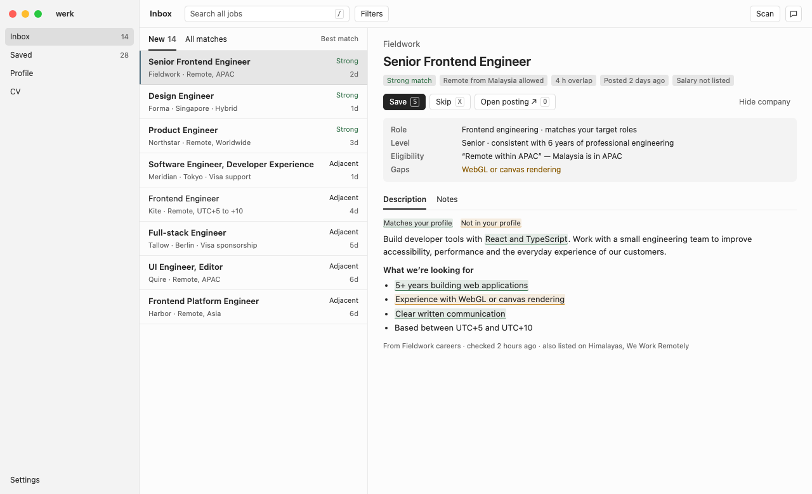

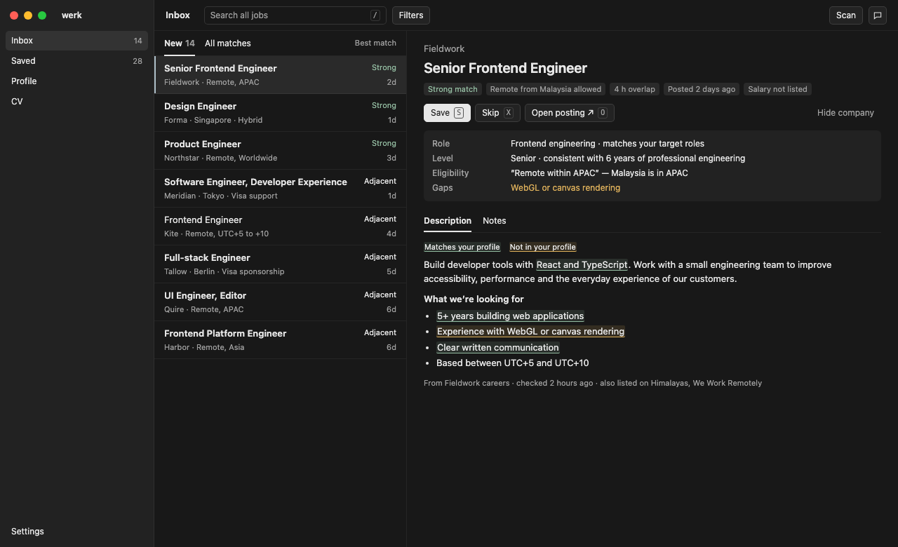

- **New**: `status = 'new'`, open, not a duplicate, best match first (`match_score`, then newest). **All matches**: every stored job except duplicates, searchable, any status.
- Row: title (bold until opened), company · location summary, match level, age. Opening a row sets `opened_at`.
- Detail: company, title, chips (match, remote eligibility, overlap, posted age, salary or "Salary not listed"), actions **Save** (S), **Skip** (X), **Open posting ↗** (O), **Hide company**. Then the decision summary (role, level, eligibility clause, gaps), **Description** / **Notes** tabs, highlight legend and highlighted description, then provenance (source, checked time, other listings).
- Save: status `saved`, snapshot description, queue a cover letter (idempotent), select the next New job. Skip: status `skipped`, select the next job. Both are undoable from the job (**Move back to New**).
- Hide company: add to `criteria.hiddenCompanies` (new profile revision); its New jobs become fingerprints; saved jobs stay.
- Search (`/`): FTS5 over title, company, location and description, within the current tab. **Filters** (temporary, not persisted beyond the session): match level, arrangement, country, posted within.
- Keyboard: J/K move, S save, X skip, O open posting, / search, Esc clears search or closes the assistant. Shortcuts are inactive while typing in a field.
- Empty New: "No new jobs." with the last scan time and **Scan now**. When a schedule is on (off by default, REB-schedule), show the next scan time instead.

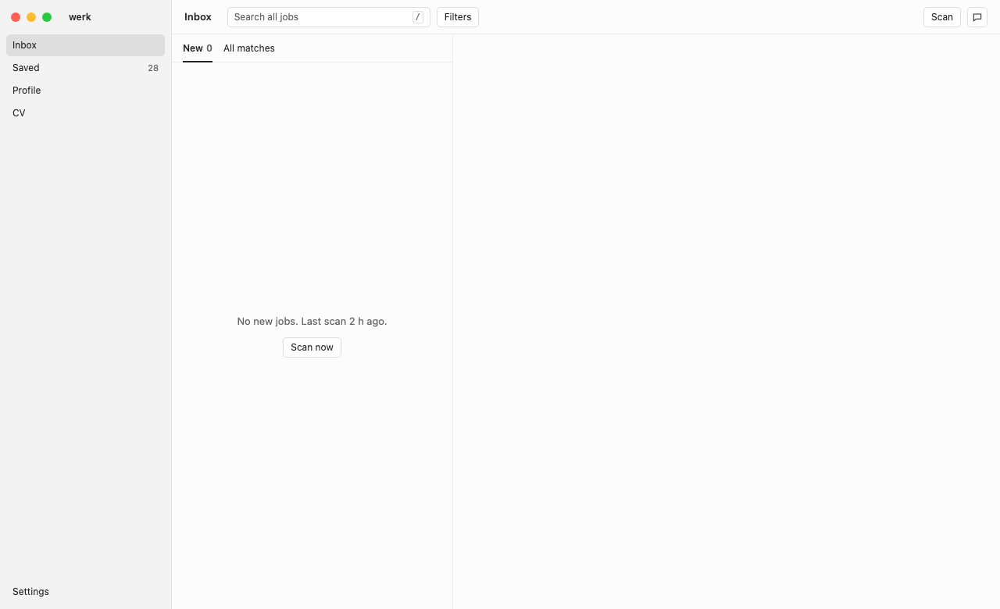

### Setup checklist

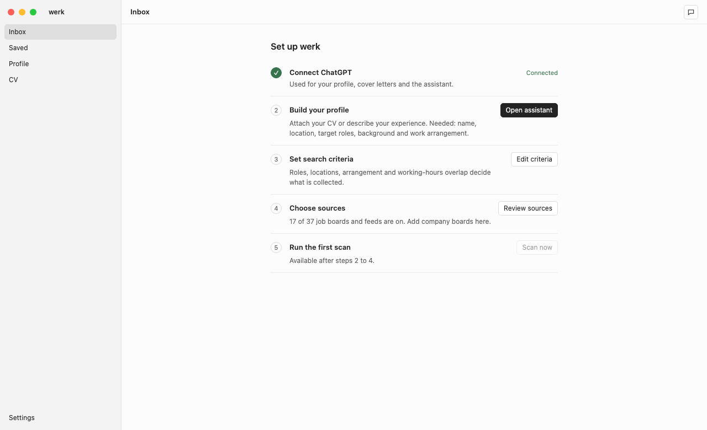

Shown in place of the Inbox until the first scan has completed. Steps: Connect ChatGPT → Build your profile (opens the assistant; attachments accepted) → Set search criteria → Choose sources (17 of 37 on by default, REB-default-sources) → Run the first scan (enabled when the profile is ready). Completed steps show their state.

### Job detail

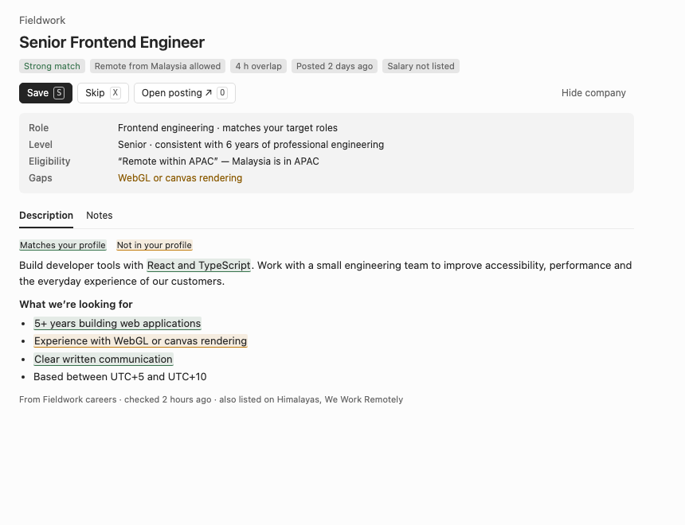

Highlights come from the matcher's spans; unmatched text has no highlight. If spans are unavailable (excerpt-only descriptions), show the summary and plain description, with **Add full description** (manual paste) for incomplete postings.

### Saved workspace

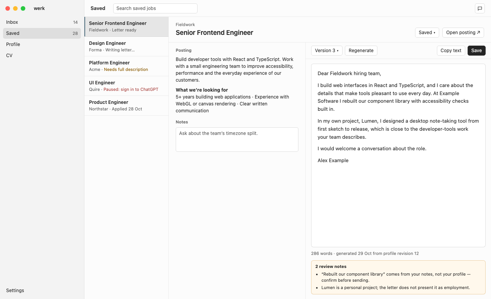

- List rows show the letter or task state: Writing letter…, Letter ready, Needs full description, Paused: reason (sign-in, allowance, error), Applied date.
- Header: company, title, status selector (Saved / Applied; Applied records `applied_at`), **Open posting ↗**.
- Left: posting (the saved snapshot) and Notes (autosave after typing pauses, with a "Saved" state).
- Right: letter toolbar (version selector, **Regenerate**, **Copy text**, **Save**), a plain-text editor, word count and generation provenance, and review notes. Saving appends a version; restoring appends a restored version. No PDF.

### Profile

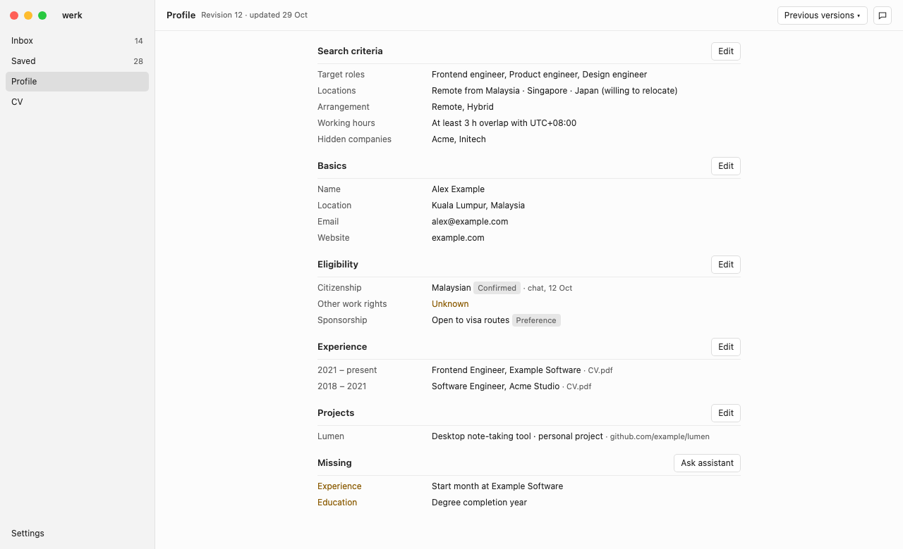

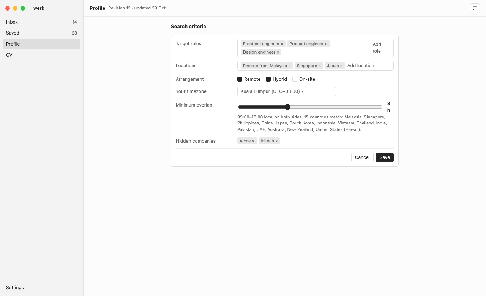

Sections: Search criteria, Basics, Eligibility, Experience, Projects, Education, Skills, Missing. Each section has **Edit** (inline form, Save/Cancel) and shows status chips (Confirmed / Preference / Inferred) and source names. **Previous versions** lists revisions with summaries and **Restore**. **Missing** lists `openItems` with **Ask assistant**. The criteria editor includes the timezone overlap control and shows which countries match, using the same function the backend uses.

### CV

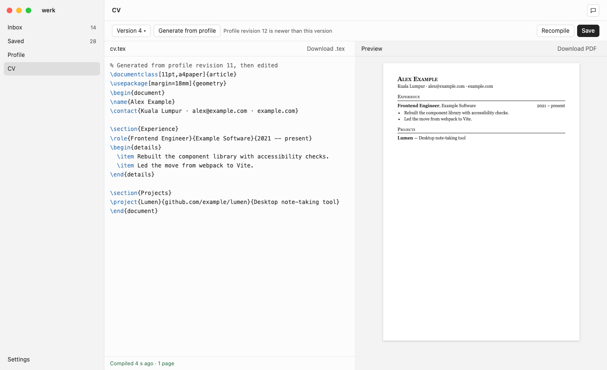

Toolbar: version selector, **Generate from profile** (new version, never overwrites unsaved edits; warn when the profile is newer than the version's `profile_revision`), **Recompile**, **Save**. Left: CodeMirror 6 with a minimal LaTeX mode, **Download .tex**. Bottom: compile status and parsed diagnostics (port `parseLatexDiagnostics`). Right: built-in PDF viewer, **Download PDF**. Dirty-edit guard on navigation and quit.

### Assistant overlay

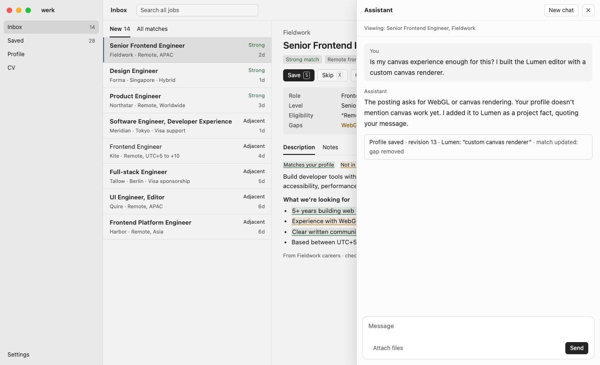

Unchanged contract: 520 px panel fixed to the right, over the page without resizing it; opened from the header; Escape or the close button hides it and returns focus; conversation, scroll position and unsent text survive navigation; **New chat** clears the chat and its attachments. The line under the header names the context the assistant receives (current page, selected job or document). Messages show save receipts (record, version, compile result). Composer: Enter sends, Shift+Enter adds a newline, **Stop** while running, **Attach files** and pasted screenshots.

### Settings

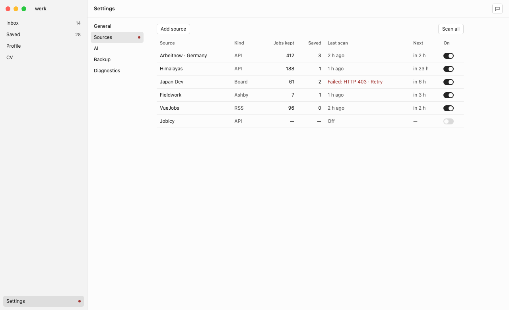

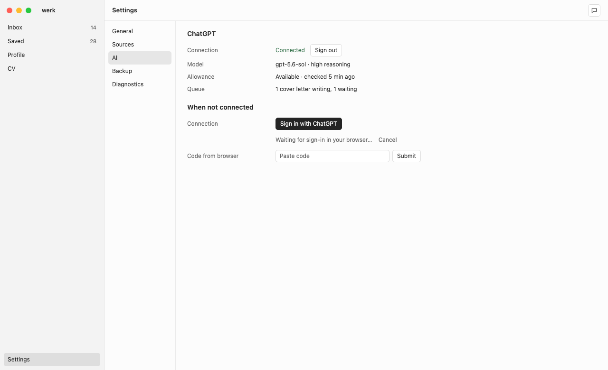

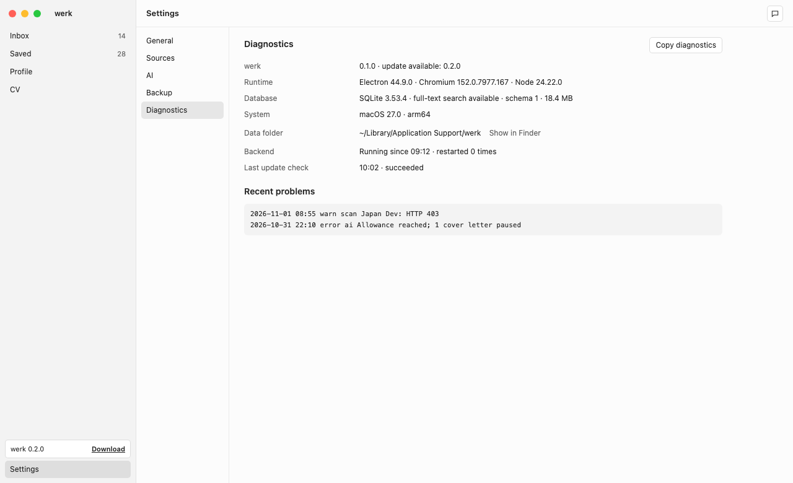

Sections: General (appearance System/Light/Dark; scan schedule: Manual (default), Every 4 hours, Every 12 hours), Sources (table with jobs kept, saved, last scan, next scan, on/off, failure with **Retry**; **Add source** accepts a Greenhouse, Ashby or Lever board URL, an RSS/Atom URL, or a catalog entry), AI (connection, model, allowance state, queue; sign-in flow with browser and manual-code fallback; **Sign out**), Backup (export/import ZIP), Diagnostics.

### Design tokens

| Token | Light | Dark |
| --- | --- | --- |
| `--bg` canvas | `#fcfcfc` | `#181818` |
| `--panel` sidebar, secondary | `#f3f3f3` | `#222222` |
| `--field` | `#ffffff` | `#181818` |
| `--raised` | `#ffffff` | `#232323` |
| `--text` | `#242424` | `#e7e7e7` |
| `--muted` | `#636363` | `#a0a0a0` |
| `--line` | `#14141412` | `#ffffff0f` |
| `--line-strong` | `#14141425` | `#ffffff20` |
| `--focus` | `#506f80` | `#adbec8` |
| `--selected` | `#14141418` | `#ffffff14` |
| `--ok` | `#36734c` | `#94bda2` |
| `--warn` (new) | `#8a5a00` | `#e0b25c` |
| `--bad` | `#a33632` | `#f49c92` |

Typography: system font; 13 px base, 12 px controls and navigation, 11 px metadata, 14 px chat with 1.65 line height, 20 px document titles. Radii: 5 px controls, 6 px menus, dialogs and panels. Heights: 44 px headers, 36 px tabs, 28 px navigation rows, 26 px buttons. Shadows only on menus, dialogs and the assistant overlay. Visible focus rings. Respect reduced motion. System theme by default: CSS uses `prefers-color-scheme` plus `data-mode` for explicit choices; main sets `nativeTheme.themeSource` to match so native chrome follows.

## Milestones

Each milestone ends with a verification run in the new wiki (`docs/wiki/verification/runs/<run-id>.md`, checked with `node ../jstack/skills/verify-change/scripts/check-reports.mjs docs/wiki`).

### M1 — shell, backend, packaging, CI

Scope: Electron app named werk; main, preload, backend utility process and RPC; migrations with `settings` and `events`; renderer shell with the four pages (empty states only: "No jobs yet.", "No saved jobs.", "No profile yet.", "No CV yet.") and Settings → General (appearance) and Diagnostics; update notice; unsigned installers; CI.

Acceptance:

- `npm run check`, `npm test`, `npm run package` pass on macOS and Windows runners.
- The packaged app starts on both platforms with a fresh `WERK_DATA_DIR`, shows the shell within 3 s, and Diagnostics reports SQLite with FTS5, schema 1 and a running backend (Playwright `_electron` smoke test).
- Windows: the NSIS installer installs silently per user (`/S`), the installed `werk.exe` passes the same smoke test, and uninstall removes the app but not the data folder.
- Killing the backend process restarts it and the UI reconnects; Diagnostics shows the restart count.
- Second launch focuses the existing window; Quit exits all processes.
- Closing the window leaves werk running (Dock on macOS, tray on Windows); reopening shows the same window and backend; **Quit werk** from the tray exits all processes.
- The release check finds a newer fake release when pointed at a test URL (inject the URL with `WERK_RELEASES_URL` in tests only).
- Installer sizes recorded in the verification run. Expected roughly 100–130 MB download (estimate, unmeasured).

### M2 — AI, profile, assistant, setup

ChatGPT sign-in and status; profile versions, fact sheet with inline editing, readiness, restore; criteria editor with overlap; assistant overlay with attachments and bounded profile actions; setup checklist (steps 1–3 functional, 4–5 shown disabled until M3). Accept: profile built entirely through the assistant from an attached CV PDF (with simulated inference in tests), direct edits versioned, restore works, sign-in errors and allowance limits shown without losing queued work.

### M3 — sources, collection, inbox

Default catalog (17 on, 20 scraped boards off), Add source, scheduler (manual by default; optional 4 or 12 hour schedule) with limits and backoff, pipeline with gating and fingerprints, reassessment on profile change, retention job, inbox triage with keyboard, job detail with highlights, Hide company, search and filters, Settings → Sources with failure states. Accept: fixture-based adapter tests; a scan with fixture HTTP responses stores only qualifying jobs; profile change moves jobs between stored and fingerprinted; New triage by keyboard only; database stays small (record its size after a live bounded scan with a fictional profile).

### M4 — saved workspace, letters, CV

Save queues a letter; serialized generation with pause/retry; plain-text editor with versions, review notes, Copy text; Applied status; CV generation from the profile, LaTeX editor, sandboxed Tectonic compilation, PDF preview and downloads; assistant actions for letters and the CV. Accept: simulated generation end to end; a few real generations with a fictional profile; compile failure keeps the previous PDF and shows diagnostics; every attempt in [Tectonic file access](#tectonic-file-access) fails inside the isolation on both platforms (an automated test per platform).

### M5 — backups, polish, first release

ZIP export/import for werk data; Diagnostics complete; keyboard and focus audit; accessibility pass; app icon ([below](#app-icon)); README install instructions ([below](#install-instructions-for-the-readme)). Then, in order, each with the user's go-ahead: rename the repository (`gh repo rename werk`, then `git remote set-url origin https://github.com/rengwu/werk.git`); the user tests the Windows installer from CI on their PC; push the first tag. CI drafts the release and the user publishes it.

## Build, packaging and release

### Versions (Verified available; pinned at least two weeks old on 1 November 2026)

`electron` 44.9.0, `electron-builder` 26.17.0, `vite` 8.3.4, `@vitejs/plugin-react` 6.1.2, `react`/`react-dom` 19.3.1, `@tanstack/react-query` 5.104.4, `typescript` 5.9.3 (avoid the 7.x native compiler for now), `esbuild` 0.28.2, `playwright-core` 1.64.1, `@types/node` 24.x (Electron 44 runs Node 24), `@types/react`/`@types/react-dom` 19.3.0, `@earendil-works/pi-ai` 1.3.0, `zod` 4.x, `pdfjs-dist` (backend PDF text), CodeMirror 6 packages, `@base-ui/react` 1.8.0 and `@phosphor-icons/react` 2.1.10 if needed. GitHub Actions: `actions/checkout@v7`, `actions/setup-node@v7`, `actions/upload-artifact@v7`, `actions/download-artifact@v8`, `actions/setup-go@v7` (v7.0.0, July 2026). Go 1.24 for the helper, as in legacy `desktop/go.mod`.

Local Node 22.19 runs `.ts` tests directly (type stripping, Verified) with SQLite 3.50.4 and FTS5. Use only erasable TypeScript syntax (`erasableSyntaxOnly`), `.ts` import extensions and `verbatimModuleSyntax`.

Put **every** package in `devDependencies`: main, preload, backend and renderer are all bundled, so electron-builder ships no `node_modules`.

### Layout

```text
package.json            tsconfig.json          vite.config.ts (root: src/renderer, base: "./", outDir: ../../out/renderer)
scripts/build.mjs       esbuild main/preload/backend → out/*.cjs (format cjs, platform node, target node24, external electron), then vite build
scripts/dev.mjs         vite dev server + esbuild watch + Electron restart; sets WERK_RENDERER_URL
scripts/setup-latex.mjs downloads Tectonic for the target platform and prepares the offline cache into resources/
tools/texsandbox/       Windows sandbox helper: one Go `package main` (go.mod with golang.org/x/sys), built to resources/runtime/win/
src/main/  src/preload/  src/backend/  src/renderer/  src/shared/
tests/*.test.ts         node --test
tests/smoke.ts          Playwright _electron against a packaged executable (WERK_EXE)
resources/              icons, geography data, Tectonic and cache (extraResources)
design/werk/            HTML mockups
.github/workflows/build.yml
```

### package.json (sketch, Unverified)

```json
{
  "name": "werk",
  "productName": "werk",
  "version": "0.1.0",
  "private": true,
  "description": "Local job discovery, fit assessment, cover letters and CV management.",
  "author": "John Goh",
  "license": "MIT",
  "type": "module",
  "main": "out/main.cjs",
  "scripts": {
    "dev": "node scripts/dev.mjs",
    "build": "node scripts/build.mjs",
    "check": "tsc --noEmit",
    "test": "node --test tests/*.test.ts",
    "package": "npm run build && electron-builder --publish never",
    "smoke": "node tests/smoke.ts"
  },
  "build": {
    "appId": "io.github.rengwu.werk",
    "productName": "werk",
    "directories": { "output": "release", "buildResources": "resources" },
    "files": ["out/**/*"],
    "extraResources": [{ "from": "resources/runtime/${os}", "to": "runtime" }, { "from": "resources/geography", "to": "geography" }],
    "mac": { "target": [{ "target": "dmg", "arch": ["arm64"] }], "category": "public.app-category.productivity", "identity": "-" },
    "win": { "target": [{ "target": "nsis", "arch": ["x64"] }] },
    "nsis": { "oneClick": true, "perMachine": false, "artifactName": "werk-${version}-setup.${ext}" },
    "dmg": { "artifactName": "werk-${version}-arm64.${ext}" }
  }
}
```

`identity: "-"` asks for ad-hoc signing, which Apple Silicon requires to run at all; check with `codesign -dv` after packaging. Do not set `CSC_LINK`.

### App icon

Decided (REB-icon): the light monogram with a green match dot. Reference: `design/werk/icon.svg` and the [preview](../attachments/werk-design/icon.png).

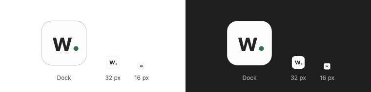

Until M5 the default Electron icon is fine. For M5:

- Redraw the "w" as outlines from an OFL font such as Inter SemiBold, or draw it by hand. Do not rasterize the system font: SF Pro's license does not allow use in an app icon, and Segoe UI may not be redistributed.
- Save the final vector as `resources/icon.svg` and export `resources/icon.png` at 1024 × 1024. electron-builder generates the `.icns` and `.ico` from it. Check the 16 px Windows rendering.
- Windows tray: `resources/tray.png` and `tray@2x.png` (16 and 32 px) from the same drawing, shipped with an `extraResources` entry.

### CI workflow (sketch, Unverified)

```yaml
name: Build
on:
  push:
    branches: [main]
    tags: ["v*"]
permissions:
  contents: read
jobs:
  build:
    strategy:
      fail-fast: false
      matrix:
        os: [macos-latest, windows-latest]
    runs-on: ${{ matrix.os }}
    env:
      CSC_IDENTITY_AUTO_DISCOVERY: "false"
    steps:
      - uses: actions/checkout@v7
      - uses: actions/setup-node@v7
        with: { node-version: 24, cache: npm }
      - run: npm ci
      - run: npm run check
      - run: npm test
      - uses: actions/setup-go@v7
        if: runner.os == 'Windows'
        with: { go-version-file: tools/texsandbox/go.mod, cache-dependency-path: tools/texsandbox/go.sum }
      - name: Build and test the LaTeX sandbox helper
        if: runner.os == 'Windows'
        working-directory: tools/texsandbox
        run: |
          go test ./...
          go build -trimpath -o ../../resources/runtime/win/texsandbox.exe .
      - run: node scripts/setup-latex.mjs
      - run: npm run package
      - name: Install on Windows
        if: runner.os == 'Windows'
        shell: pwsh
        run: |
          $setup = Get-ChildItem release -Filter '*-setup.exe' | Select-Object -First 1
          Start-Process -FilePath $setup.FullName -ArgumentList '/S' -Wait
          "WERK_EXE=$env:LOCALAPPDATA\Programs\werk\werk.exe" | Out-File -Append $env:GITHUB_ENV
      - name: Locate app on macOS
        if: runner.os == 'macOS'
        run: echo "WERK_EXE=$PWD/release/mac-arm64/werk.app/Contents/MacOS/werk" >> "$GITHUB_ENV"
      - run: npm run smoke
      - uses: actions/upload-artifact@v7
        if: always()
        with:
          name: werk-${{ runner.os }}
          path: |
            release/*.dmg
            release/*-setup.exe
            smoke-output/
          retention-days: 7
  release:
    if: startsWith(github.ref, 'refs/tags/v')
    needs: build
    runs-on: ubuntu-latest
    permissions:
      contents: write
    steps:
      - uses: actions/download-artifact@v8
        with: { path: dist }
      - env: { GH_TOKEN: "${{ github.token }}" }
        run: |
          gh release create "$GITHUB_REF_NAME" --repo "$GITHUB_REPOSITORY" --draft --title "werk $GITHUB_REF_NAME" --notes "" dist/*/*.dmg dist/*/*-setup.exe
```

Release process: bump `version` in `package.json`, commit, tag `vX.Y.Z`, push the tag (only when the user asks). CI drafts the release; the user reviews and publishes it, which makes the in-app notice appear for older versions.

### Install instructions for the README

- **macOS:** open the `.dmg`, drag werk to Applications. The first open is blocked because the app is unsigned: open System Settings → Privacy & Security and click **Open Anyway** for werk. If macOS says the app is damaged, run `xattr -dr com.apple.quarantine /Applications/werk.app`.
- **Windows:** run `werk-X.Y.Z-setup.exe`. If SmartScreen shows "Windows protected your PC", click **More info → Run anyway**. werk installs for the current user and opens.
- **Updates:** werk shows a notice when a newer release exists; download and install it the same way. Your data stays in the data folder.

### Code sketches (Unverified)

Main process essentials:

```ts
import { app, BrowserWindow, Menu, MessageChannelMain, Tray, ipcMain, nativeTheme, shell, utilityProcess, type UtilityProcess } from "electron";
import { join } from "node:path";

if (process.env.WERK_DATA_DIR) app.setPath("userData", process.env.WERK_DATA_DIR);
else if (!app.isPackaged) app.setPath("userData", join(app.getPath("appData"), "werk-dev"));
if (!app.requestSingleInstanceLock()) app.exit(0);

let backend: UtilityProcess | null = null;
let win: BrowserWindow | null = null;
let quitting = false;
const restarts: number[] = [];

function startBackend(previousExit?: string) {
  const child = utilityProcess.fork(join(__dirname, "backend.cjs"), [], { serviceName: "werk-backend" });
  child.once("spawn", () => {
    child.postMessage({ type: "init", dataDir: app.getPath("userData"), version: app.getVersion(),
      system: `${process.platform} ${process.getSystemVersion()} ${process.arch}`, previousExit });
    if (win) connect();
  });
  child.once("exit", (code) => {
    backend = null;
    if (quitting) return app.quit();
    const now = Date.now();
    restarts.push(now);
    if (restarts.filter((t) => now - t < 60_000).length > 3) return win?.webContents.send("werk:backend-failed");
    setTimeout(() => startBackend(`Backend exited with code ${code}`), 1000);
  });
  backend = child;
}

function connect() {
  if (!backend || !win) return;
  const { port1, port2 } = new MessageChannelMain();
  backend.postMessage({ type: "connect" }, [port1]);
  win.webContents.postMessage("werk:backend-port", null, [port2]);
}

function openExternal(url: string) {
  if (/^https?:\/\//i.test(url)) void shell.openExternal(url);
}

function createWindow() {
  win = new BrowserWindow({
    width: 1280, height: 820, minWidth: 900, minHeight: 600, show: false, title: "werk",
    backgroundColor: nativeTheme.shouldUseDarkColors ? "#181818" : "#fcfcfc",
    titleBarStyle: process.platform === "darwin" ? "hiddenInset" : "default",
    trafficLightPosition: { x: 14, y: 15 }, autoHideMenuBar: true,
    webPreferences: { preload: join(__dirname, "preload.cjs"), sandbox: true, contextIsolation: true, plugins: true },
  });
  win.once("ready-to-show", () => win?.show());
  win.webContents.setWindowOpenHandler(({ url }) => (openExternal(url), { action: "deny" }));
  win.webContents.on("will-navigate", (event, url) => { event.preventDefault(); openExternal(url); });
  win.on("closed", () => (win = null));
  const dev = process.env.WERK_RENDERER_URL;
  void (dev ? win.loadURL(dev) : win.loadFile(join(__dirname, "renderer/index.html")));
}

ipcMain.on("werk:connect", connect);
ipcMain.on("werk:theme", (_e, mode: "system" | "light" | "dark") => (nativeTheme.themeSource = mode));
app.on("second-instance", () => { if (win) { if (win.isMinimized()) win.restore(); win.focus(); } else createWindow(); });
app.on("activate", () => { if (!win) createWindow(); });
app.on("window-all-closed", () => {});    // keep running until Quit (REB-tray)
let tray: Tray | null = null;
function createTray() {                    // Windows only
  tray = new Tray(join(process.resourcesPath, "tray.png"));
  tray.setToolTip("werk");
  tray.on("click", () => (win ? win.show() : createWindow()));
  tray.setContextMenu(Menu.buildFromTemplate([
    { label: "Open werk", click: () => (win ? win.show() : createWindow()) },
    { label: "Quit werk", click: () => app.quit() },
  ]));
}
app.on("before-quit", (event) => {
  if (!backend || quitting) return;
  quitting = true;
  event.preventDefault();
  backend.postMessage({ type: "shutdown" });
  setTimeout(() => backend?.kill(), 3000);
});
void app.whenReady().then(() => { startBackend(); createWindow(); if (process.platform === "win32") createTray(); });
```

Note: in `will-navigate`, allow the dev server's hot reload if it navigates; otherwise all navigation is blocked.

Preload:

```ts
import { contextBridge, ipcRenderer } from "electron";
ipcRenderer.on("werk:backend-port", (event) => window.postMessage("werk:backend-port", "*", event.ports));
contextBridge.exposeInMainWorld("werk", {
  platform: process.platform,
  connect: () => ipcRenderer.send("werk:connect"),
  setTheme: (mode: string) => ipcRenderer.send("werk:theme", mode),
});
```

Backend entry:

```ts
import type { MessagePortMain } from "electron";
let ports = new Set<MessagePortMain>();
process.parentPort.on("message", ({ data, ports: transferred }) => {
  if (data.type === "init") init(data);                 // open DB, migrate, log previousExit, start scheduler
  else if (data.type === "connect") attach(transferred[0]);
  else if (data.type === "shutdown") { db.close(); process.exit(0); }
});
function attach(port: MessagePortMain) {
  ports.add(port);
  port.on("message", async ({ data: { id, method, params } }) => {
    try { port.postMessage({ id, result: await handlers[method](params) }); }
    catch (error) { log("error", "rpc", `${method}: ${String(error)}`); port.postMessage({ id, error: { message: "Request failed." } }); }
  });
  port.on("close", () => ports.delete(port));
  port.start();
}
export const emit = (event: string, data?: unknown) => { for (const port of ports) port.postMessage({ event, data }); };
```

Renderer client: keep one `MessagePort`; queue calls until connected; on a new port, reject pending calls and invalidate all queries; `call()` returns a promise keyed by `id`; `on(event, fn)` subscribes to pushes.

## Verification

- Unit tests (`node --test`): migrations on a temp database; FTS5 sync triggers; pipeline gating, fingerprints and reassessment with fixtures; matching, eligibility, deduplication, locations and overlap (port legacy tests); update version comparison; diagnostics redaction; letter validation.
- Smoke test (`tests/smoke.ts`): launch `WERK_EXE` with a temp `WERK_DATA_DIR`; wait for the shell; open Settings → Diagnostics; assert FTS5, schema version and backend running; screenshot to `smoke-output/`; quit; relaunch to check persistence. Later milestones extend it with simulated inference (`WERK_FAKE_AI=1`, test builds only).
- Never use the user's real data folder or profile in tests. Live checks are allowed (REB-live-checks) and kept small: a few real generations per milestone in the development build, and bounded read-only scans within each source's limits. Use a fictional profile. Record each live check in the verification run. Real inference needs a ChatGPT sign-in in the development data folder, which only the user can complete: start the sign-in in M2 and ask the user to finish it in the browser.
- Evidence in the wiki uses fictional data only.

## Wiki structure

The wiki restarted on 1 November with the home page, decision register, open questions, journal and design attachments. Add the rest when a milestone needs it:

```text
docs/wiki/
  _build.mjs                     copied from ../jstack/skills/wiki/assets
  index.md                       werk wiki home (exists)
  decisions/index.md             decision register (exists)
  discussions/open-questions.md  (exists)
  journal/2026-11-01-*.md        rebuild plan, transcripts, this handoff (exist)
  attachments/werk-design/       design PNGs (exist)
  features/index.md, features/<feature>.md   FEAT-* records per milestone (feature-map skill)
  verification/setup.md, verification/index.md, verification/runs/<run-id>.md
  evidence/<run-id>/             fictional screenshots and result JSON
```

As features are built, move their specification from this handoff into feature pages and link back; this page then stays as the dated record.

Build and check after every documentation change: `node docs/wiki/_build.mjs && node docs/wiki/_build.mjs --check`. Never edit the generated `index.html`.

## Questions resolved before handoff

The nine open questions from the first draft of this page were answered in [round 3](2026-11-01-grill-28a582f50b30795a161c06d0221e222e.md), [round 4](2026-11-01-grill-79bc64157692f581ef75d39f3c59308f.md) and [round 5](2026-11-01-grill-9472293cf4bb700313881eac8d7833b7.md). Later questions are in [Open questions](../discussions/open-questions.md).

| Question | Answer |
| --- | --- |
| Old app removal | Deleted on 1 November (REB-retire). |
| Pushing | Push `main` and `legacy` without asking (REB-github). Work directly on `main` (REB-branch). |
| Windows close behavior | System tray (REB-tray). |
| LaTeX isolation on Windows | OS sandbox on both platforms; the legacy Go AppContainer helper on Windows (REB-latex-isolation). |
| Repository name | Rename to `werk` at the first release (REB-rename). |
| App icon | Light monogram with match dot (REB-icon). |
| Default sources | 17 APIs and feeds on; 20 scraped boards off (REB-default-sources). |
| Scan schedule default | Manual (REB-schedule). |
| Slopchan discussion | Dropped; the wiki holds all documentation (REB-docs). |

The draft `AGENTS.md` that was Appendix A is now the repository's `AGENTS.md`.

## Default source catalog

Decided groups: keep sources that produced saves, company boards, structured feeds/APIs and scraped public boards; drop Hacker News, X and boards that never returned a job. Decided defaults for new users (REB-default-sources): the 8 aggregator APIs and 9 RSS feeds on; the 20 public boards available but off; company boards added by the user (the old catalog's company entries were the previous user's choices).

| Group | Sources (legacy adapter) |
| --- | --- |
| Aggregator APIs (on) | Himalayas (`himalayas`), Remote OK (`remoteok`), Remotive (`remotive`), 4 Day Week (`fourdayweek`), Arbeitnow Germany and UK (`arbeitnow`), Jobicy (`jobicy`), Working Nomads (`workingnomads`) |
| RSS feeds (on) | VueJobs, RemoteJobs.com, We Work Remotely Programming/Design/Product, GolangProjects, LaraJobs, ClojureJobboard, WordPress Jobs (`rss`) |
| Public boards (off; `core/boards/catalog.ts` parsers) | Japan Dev, TokyoDev, TryRemote, Dynamite Jobs, Hiredly, LinkedIn public jobs, Wellfound, Built In, Y Combinator jobs, Cake, Arc, Get on Board, Remote.com Jobs, No Fluff Jobs, Remote Game Jobs, Jobspresso, Wantedly, Relocate.me, JobStreet / SEEK, Glints |
| Company boards (user-added) | Greenhouse, Ashby and Lever boards by URL or slug. The previous catalog included Anthropic, Cognition, LangChain, Supabase, Figma, Notion, Cursor, Replit, Vercel, Linear and Sourcegraph; offer them as suggestions only if the user wants. |
| Dropped | Hacker News Who's Hiring, Hacker News YC jobs, X search, Indeed, Careerjet, Jooble, Adzuna, Tech in Asia, Welcome to the Jungle / Otta, NodeFlair, Tech Jobs for Good, Foorilla, Web3.career |

Keep the legacy per-source limits: at most six scans per source per day, per-scan request caps, conditional requests, rate-limit backoff, resumable pagination, provider cooldowns (Himalayas daily, Remotive four per day). Scraped boards break when sites change: a parser failure marks the source failed with the HTTP status or parse error and never deletes jobs.
